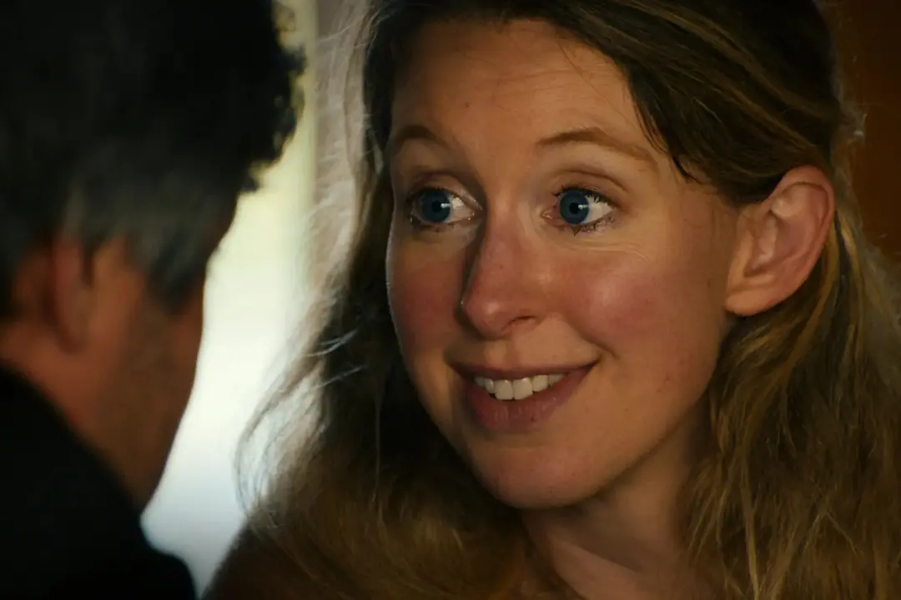

# You can see everything

Is a wild ass movie

WATCH IT FIRST!! Do not go on please it's so good don't read if you haven't
seen it yet

## The "main point" of the film

The first thing I had to wrap my head around was the central idea of the film.
I think that each character in the film creates an idea of who Elizabeth Holmes
is (including Elizabeth herself). The main conflict of the film is how each of
these interpretations are at odds with each other.

* The public

The public's interpretation of Elizabeth Holmes comes from the depiction of her
in *The Dropout*. They see her as a manipulative narcissist who celebrates
her lies and victories behind closed doors (think the "do it for the money"
scene or whatever they say)

* Elizabeth Holmes

Elizabeth tries to portray herself as an innocent person with a passion for
inventing. She believes that the public never gets a glimpse at the "real her"
because of her dramatized appearance in The Dropout. She is also at odds with
the famous picture of her holding the blood sample chip

* Billy

Billy sees Elizabeth as a living martyr. He idolizes her and elevates her as
a generational innovator. He uses this depiction of her for his own status
when he talks in her name. He is intensely controlling, not just of Elizabeth's
image, but of Elizabeth herself.

* Nathan

Nathan is convinced that there is a "real" Elizabeth hiding behind the characters
that Billy and Elizabeth create. There are multiple scenes in the film where
he tries to get into her head, only for her to shut him down. (Who's on first, and
the prison visit). Nathan hopes that the real Elizabeth might be a caring
and genuine person who is trapped by Billy and the public.

* Amanda Seyfried

Amanda is the "voice of reason" in the film, who directly cuts through Elizabeth's
carefully crafted image. This causes a few direct conflicts (the fight with Billy,
and Elizabeth's distrust with her, specifically saying that she "knew what she
was doing in her portryal in The Droupout, woman to woman"). Amanda thinks that 
Elizabeth is fundamentally a bad person, and Amanda thinks that Elizabeth knows 
exactly how she is crafting her image (here I specifically mean the scene where
Elizabeth walked out of the room so that Billy could talk about profiting from the film)

## What do I think

I have to side with Amanda, mostly. It's difficult to believe that someone who was
able to so carefully manipulate older investors couldn't keep up some sort of
innocent image. At one point in the film they bring up the fact that Elizabeth 
was specifically able to woo older male investors, which honestly holds up with
her innocent doe image. 

Nathan believes (or does he? we know he's a mastermind about this stuff) that
Elizabeth was being specifically vulnerable with him because of their connection.
Think the acted-out scene with Amanda as Elizabeth, when Nathan went to their house
and met the two of them for the first time. And the hug that Nathan describes in the
prison visit, which he felt was personal and genuine (he describes a "shaking" that
would be difficult to fake). And he believes that her love for Billy is genuine.
But Amanda contends that this sort of thing is her bread and butter, as if Nathan
was just another investor.

It brings up the question of why Nathan was invited over in the first place. The
project was, to Elizabeth, a chance to allow the public to see the real her, and
not the businesswoman her. (The pivotal quote in the movie being, "I was playing a
character that I made".) But to Billy, it was a chance to clean her image, and
Nathan was probably the only type of person that Billy thought wouldn't drag
them through the mud.

## Who is at fault? Billy or Elizabeth?

One point that Amanda brings up repeatedly is that she thinks that Elizabeth
is "cleaning her hands", i.e. Elizabeth is very intentionally removing immplications
of guilt or the idea that she knew of any sort of wrongdoing. I totally agree on this.
The first half of the movie is filmed in a way which portrays Billy as the main
villain (controlling and always dragging Elizabeth away in important interview moments).
But Amanda recontextualizes all of this at the end when she brings up Nathan's
emotional connection to Elizabeth. Given the two possibilities, that:

* Elizabeth is genuinely an innocent person, who words things specifically in a way that
makes sense to her. And therefore she never committed any wrongdoing, and any malicious
intent was from other sources like Billy or her other business partners whose names I'm
forgetting

or, that

* Elizabeth intentionally lied to investors in the past, and is now on the plot with 
Billy and is working very closely with him to craft her innocence

I'd go with the second one.

And of course, it would make the whole inviting an entire film crew into your house a bit
more believable.

## Okay.. now that we understand the movie a little more..

### What is truth?

Of course, to Elizabeth, truth is whatever words you can put out into the world. But
she did go to jail.

### Do I feel bad for Elizabeth Holmes?

It's really hard not to sympathize with Elizabeth and Nathan. Especially in the scenes
just before she goes to jail. Despite all the lying and stuff, she does have two children.
And her parents are also sort of voices-of-reason, since they hate Billy so much. 

But did her fake shit have an affect on real life people? Yes. lol. Billy tries to write
it off as "three people who didn't provide any evidence". But Theranos' shit was literally
everywhere. So I really don't buy her incessant pleading that she doesn't care about the
money. To me, that's another way that she's trying to retroactively fix her past.

In fact I wish they had put a bit more about Theranos in the film. Of course I'm going to go
into a rabbit hole about it now but I want to know the breadth of the the lies and 
what kinds of fake diagnoses they were attributing.

I mean specifically that whole line about the "chemistries". Like oh my god I'm having
flashbacks. This is very personal but at QCDx Fyl would constantly go on about how our
device should have the capability to perform any type of assay in the future. Of course
at the time we were developing one specific assay. But it is another way to dupe investors
by essentially putting the burden of proof on something else that is not your
class IV medical device, lol. Yes I read ISO-13485 and 
[21 CFR part 820](https://www.ecfr.gov/current/title-21/chapter-I/subchapter-H/part-820)

### Charlie Kirk

Did not dawn on me that those scenes were filmed in 2025. Lol. I laughed out loud when they
said Charlie Kirk but then realized that not everybody in the theater has my political views.
lol

### Wow this movie is so funny

Thank god for Nathan Fielder because even when he discusses a fraudster maniac he still 
manages to put a fart joke in there. But unfortunately now I know that the awkward man
bit is a character. Only took 15 years. But I guess it is a movie about characters

### What does it mean to be a figurehead?

Many figureheads get punished for lots of things. Charlie Kirk. Elizabeth Holmes. Idk who
else. Zuckerberg, I guess, for that Facebook trial (even though he's just gonna get a slap
on the wrist). Elizabeth wants people to believe that the businesswoman Elizabeth and the home
woman Elizabeth are two different people. Is that true? 

### Did Elizabeth ever have good intentions?

It makes you wonder when it flipped from being a geniune innovative idea to being
a scam art. Or whether that was the plan from the beginning. They would have you belive, with 
the Thernaos 2.0 thing, that it was always for a good cause. But of course that's probably
their way of sanitizing the past, again. 

### Do you buy the dating story?

Like obviously I don't buy Billy's account of events, when he suggests that he didn't
know who Elizabeth was when he met her. This story reeks of their carefully coordinated
plan, like how they both remember the exact specific details of her sunglasses and mark
on her face. So then what's the point? If the love is genuine why go to such lengths to
hide the fact that he knew her beforehand? Otherwise it wouldn't matter. I really just
think that Billy saw a business opportunity. But again it's hard to say that when they
do actually have a family. I mean that's how they got to Nathan, lol. Would be a little
heartless of me to say that they have a family just so that Elizabeth doesn't look like
a demon, but it's certainly possible.

### Does Elizabeth Holmes know?

I'm no psychologist. But I want to know whether Elizabeth knows that she's putting on an
act, or not. Basically the question at the heart of Amanda's and Nathan's discussions.
Like does she genuinely believe the things she says. I still can't tell. It's genuinely
impressive. 
